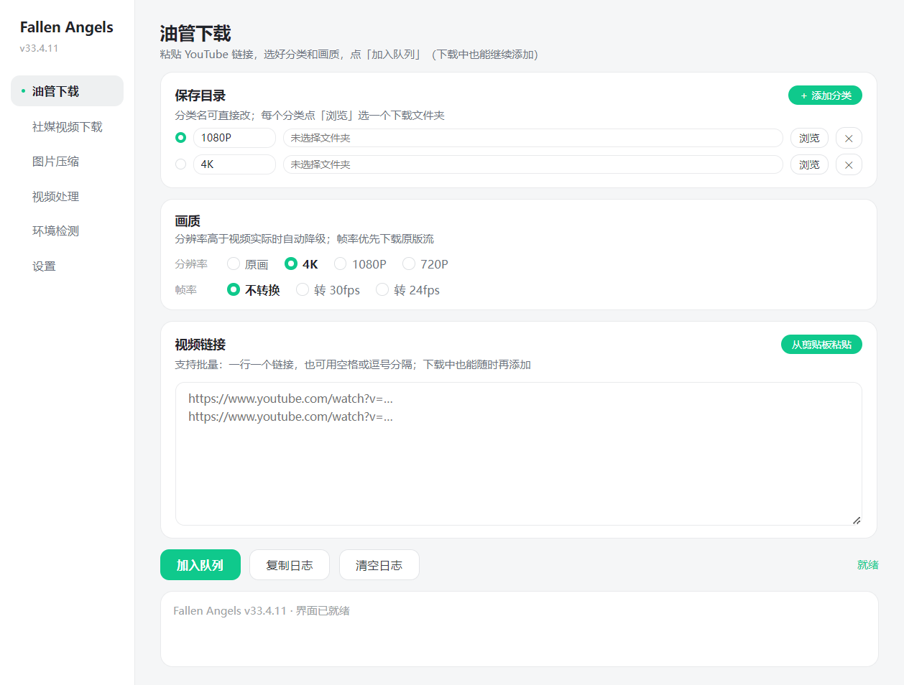
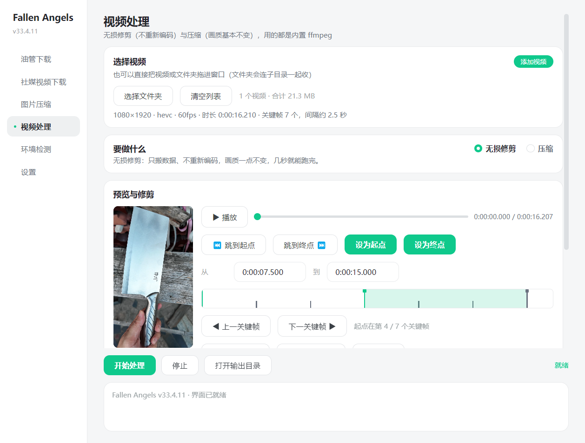
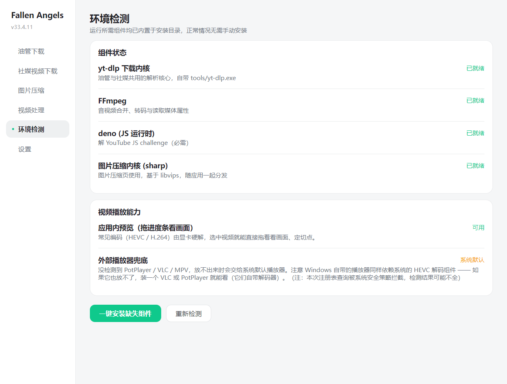
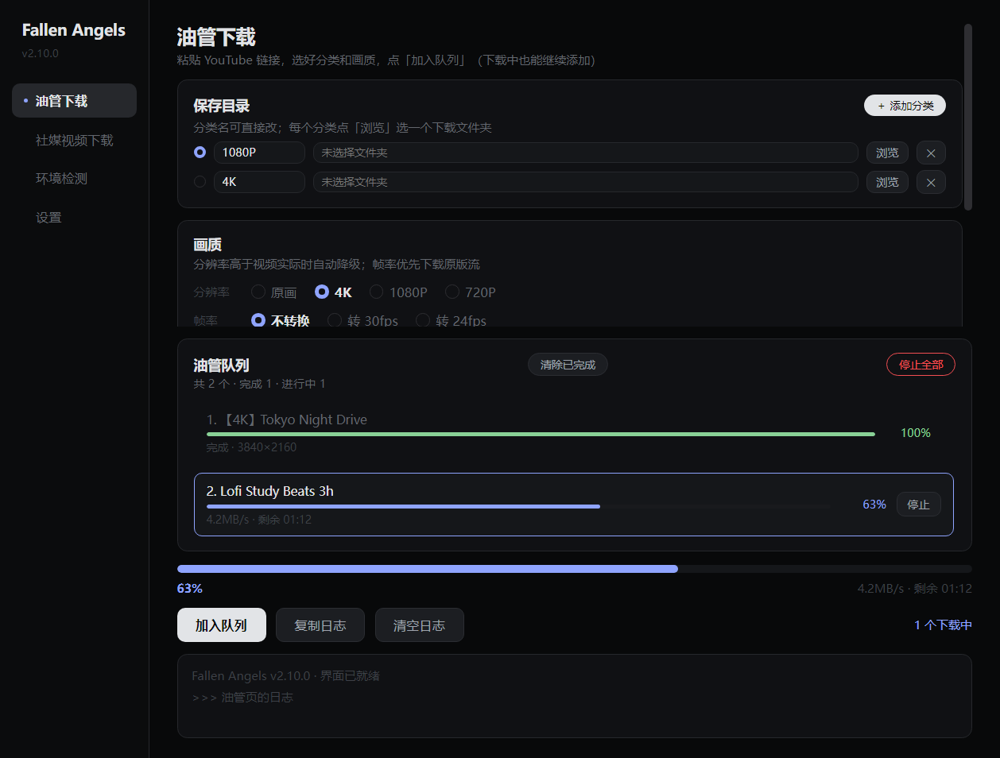

# Fallen Angels（ytdlp4k）

YouTube 4K 下载器 + 视频处理 + 图片压缩，一套搞定的 Windows 桌面工具（Electron）。
基于 [yt-dlp](https://github.com/yt-dlp/yt-dlp) 内核，内置 yt-dlp / ffmpeg / deno 全部组件，装完离线即用。



## 下载

到 [Releases](https://github.com/jackyzbn-eng/FallenAngels_ytdlp4k/releases/latest) 下载 `FallenAngels_setup.exe`，双击安装即可。
组件已全部内置（约 350MB），不需要再联网装任何东西；覆盖安装不丢配置。

## 功能

### 🎬 下载
- 分辨率档位：原画 / 4K / 1080P / 720P，档位高于视频实际最高时自动降级
- 保存分类：每个分类绑一个文件夹，下载前按分类归档
- 下载队列：并行上限 3、**随时追加任务**（不用等当前任务跑完）、同一视频自动去重
- 代理三档：跟随 Windows 系统代理 / 手动指定 / 强制直连
- 读取浏览器登录态（Firefox / Chrome / Edge），会员与年龄限制视频也能下

### ✂️ 视频处理
- **无损修剪**：不重新编码，画质 100% 不变，几秒跑完
- **关键帧轨道**：整片关键帧画成刻度，单击设起点、Shift+单击或右键设终点、◀▶ 逐格微调，切点自动吸附
- **视频预览**：应用内直接拖动看画面定切点（HEVC 原片直接播，无需转码）；放不出来时一键交给外部播放器，自动优先 PotPlayer / VLC / MPV 这类自带解码器的
- **压缩**：NVENC 硬件编码 / x265 软编可选，批量处理



### 🖼️ 图片压缩
- 批量压缩、格式转换、质量预设

### 🎨 外观
- 5 套皮肤随时切换：**WorkBuddy 浅色** / 浅色极简 / 深色 Linear（默认）/ 渐变科技 / 深色霓虹

### 🔍 环境检测
- 内置组件（yt-dlp / ffmpeg / deno）逐项自检，视频播放能力一屏说明



## 深色皮肤



## 常见问题

**报 `n challenge solving failed`？**
内置 deno 就是解这个的，到「环境检测」页确认它「就绪」。程序只用自带 `tools/yt-dlp.exe`，不会用系统 PATH 上的 pip 版。

**下载只有 1080P，没有 4K？**
- 确认视频源本身提供 4K，档位选「原画」再试
- 走代理时 YouTube 会按节点特征降级格式列表（Hysteria2 等 UDP 协议节点通常能拿到完整 4K 列表）

**下载会员 / 年龄限制视频失败？**
- 在代理设置旁选择已登录 YouTube 的浏览器（Firefox / Chrome / Edge）读取登录态；Chrome / Edge 需先完全退出浏览器

**视频预览放不出来？**
- 多半是这台电脑没装 HEVC 解码组件（Windows 默认不带，跟有没有独显关系不大）。不影响修剪 —— 点「用 PotPlayer / VLC 打开」看画面，或装一个 VLC / PotPlayer（自带解码器）

## 配置

配置保存在 `%APPDATA%\Fallen Angels\config.json`，程序自动维护；皮肤、代理、下载选项在界面上改完即存。

## 开发

```
ytdlp4k/
├── electron/        # Electron 主进程 + 打包配置（electron-builder）
│   ├── main.js      # 主进程：下载队列、视频/图片处理、IPC
│   ├── preload.js   # contextBridge 暴露 window.api
│   └── _selftest.js / _pvtest.js / _skintest.js   # 界面自检脚本
├── web/             # 渲染层（原生 HTML/CSS/JS，无框架）
│   ├── index.html
│   └── ui/          # app.js / style.css / themes.css（皮肤变量集）
└── tools/           # 运行时组件（yt-dlp / ffmpeg / deno，不入库）
```

```bash
cd electron
npm install
npm start            # 开发运行
npm run dist         # 打包安装包（输出到 electron/dist/）
```

## 许可证

[MIT](LICENSE)
